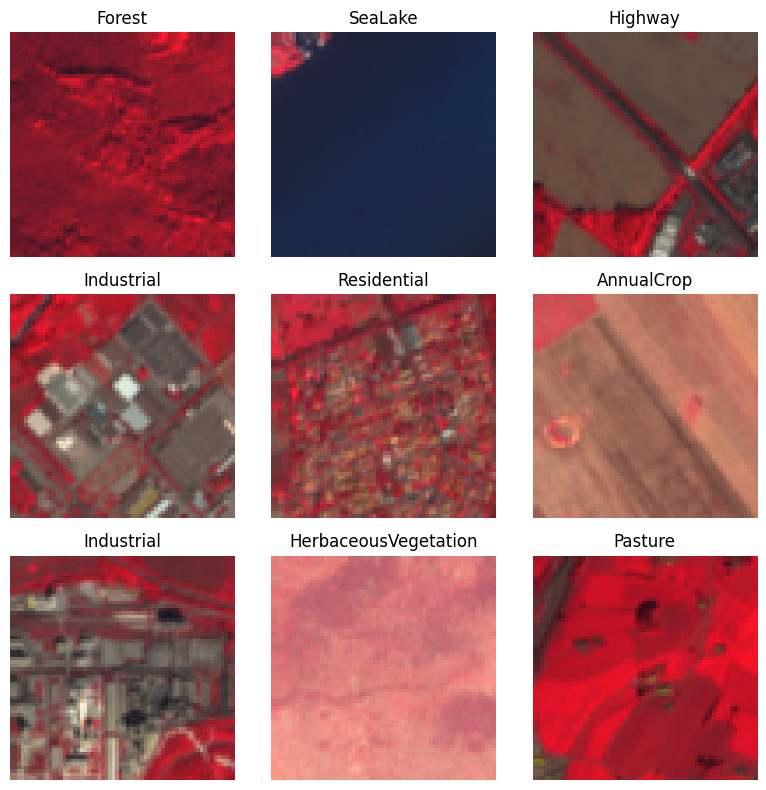
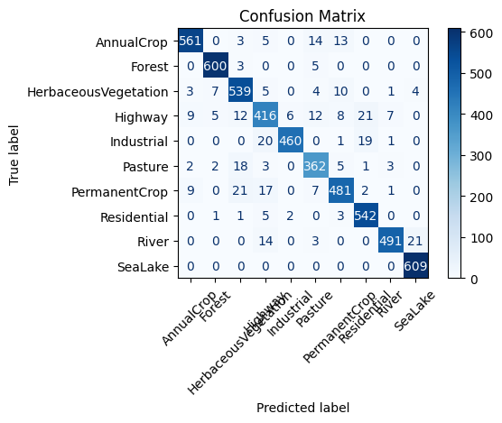
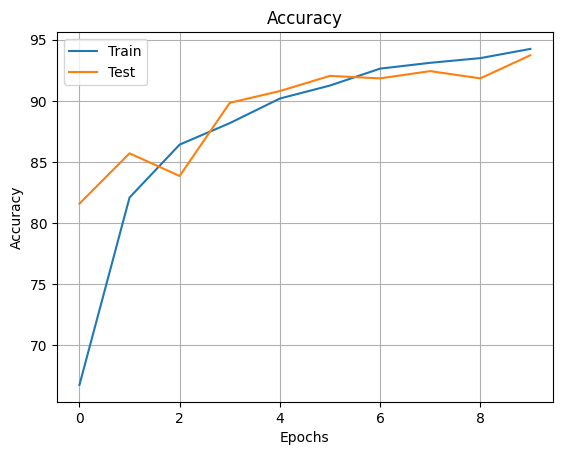

# EuroSAT Land Cover Classification (13-band Sentinel-2)

A custom CNN in PyTorch that classifies 64×64 Sentinel-2 satellite patches into 10 land-cover classes using **all 13 spectral bands**, not just RGB. It reaches **93.7% test accuracy** (macro F1 0.934) after 10 epochs, trained on CPU.

Built as my capstone project for the PG Certificate in Data Science & AI at IIT Roorkee (2025).



*False-colour composite (NIR, red, green): healthy vegetation appears red because plants reflect strongly in the near-infrared.*

## Results

Test set: 5,400 patches (TorchGeo's standard split), model after epoch 10.

| Metric | Value |
| --- | --- |
| Test accuracy | 93.7% |
| Macro F1 | 0.934 |
| Train accuracy (final epoch) | 94.2% |
| Parameters | 2.20 M |

Per-class results, computed from the confusion matrix:

| Class | Test patches | Precision | Recall | F1 |
| --- | ---: | ---: | ---: | ---: |
| SeaLake | 609 | 96.1% | 100.0% | 0.980 |
| Forest | 608 | 97.6% | 98.7% | 0.981 |
| Residential | 554 | 92.6% | 97.8% | 0.952 |
| AnnualCrop | 596 | 96.1% | 94.1% | 0.951 |
| River | 529 | 97.4% | 92.8% | 0.951 |
| Industrial | 501 | 98.3% | 91.8% | 0.949 |
| HerbaceousVegetation | 573 | 90.3% | 94.1% | 0.921 |
| PermanentCrop | 538 | 92.3% | 89.4% | 0.908 |
| Pasture | 396 | 88.9% | 91.4% | 0.902 |
| Highway | 496 | 85.8% | 83.9% | 0.848 |

**Where the model struggles:** Highway is the weakest class. 21 Highway patches were predicted as Residential, and 20 Industrial patches were predicted as Highway, which makes sense since roads run through both. 21 River patches were predicted as SeaLake, and 21 PermanentCrop patches as HerbaceousVegetation.

<p>
  
  
</p>

## Dataset

[EuroSAT](https://ieeexplore.ieee.org/document/8736785) is built from ESA Sentinel-2 imagery: 27,000 labelled, geo-referenced 64×64 patches across 10 land-use and land-cover classes, each with 13 spectral bands. This project loads it through [TorchGeo](https://github.com/microsoft/torchgeo) using the train/val/test split from [In-domain representation learning for remote sensing](https://arxiv.org/abs/1911.06721) (16,200 / 5,400 / 5,400).

## Model

Three convolution blocks (Conv 3×3 → ReLU → MaxPool) widening from 13 input bands to 32, 64 and 128 channels, followed by a 256-unit dense layer with dropout 0.5 and a 10-way output. Inputs are normalised per band. Trained with Adam (learning rate 1e-4), cross-entropy loss and batch size 64 for 10 epochs.

## How to run

```bash
pip install -r requirements.txt
jupyter notebook notebooks/eurosat_cnn_classification.ipynb
```

The first run downloads the dataset (about 2 GB) into `data/`. The notebook was originally run on Google Colab.

## Limitations and next steps

- **The test set was used for per-epoch evaluation, and the validation set is loaded but unused.** The epoch count was fixed at 10, so the reported number is likely close to fair, but the correct protocol is to monitor on validation and evaluate on test once.
- **No random seed is set**, so results vary slightly between runs.
- **The trained model isn't saved**, so there's no checkpoint to reuse.
- **95% of the parameters sit in the first dense layer** (8,192 → 256). Global average pooling would cut the model size sharply.
- **No baseline yet.** A non-deep baseline (such as a random forest on per-band statistics) would show how much the CNN actually adds.

## Tech stack

Python · PyTorch · TorchGeo · scikit-learn · Matplotlib

## License

[MIT](LICENSE)
